# MiniDEX 实验报告

**基于恒定乘积 AMM 的去中心化交易所与跨 DEX 原子套利**

浙江大学《区块链与数字货币》第二次作业

| 基本信息    | 内容                                                    |
|:----------- |:------------------------------------------------------- |
| 学号 / 姓名 | 3230106207 / 唐洪强                                     |
| 项目名称    | MiniDEX                                                 |
| 开发环境    | Solidity、Hardhat、React、TypeScript、Ganache、MetaMask |
| GitHub 仓库 | 【填写公开仓库链接】                                    |
| 实验日期    | 2026 年 10 月                                           |

## 1. 实验目标与整体方案

这次作业要求实现一个采用 AMM 机制的 DEX。除了代币兑换，还需要让用户在网页上创建交易池、提供和撤出流动性，并用 ERC721 NFT 记录每个 LP 仓位。最后通过多用户模拟观察池的运行情况；Bonus 则是利用两个 DEX 之间的价格差进行原子套利。

基于助教提供的GitHub代码，我把项目分为三个部分：

- **智能合约**：`MockToken.sol` 负责测试代币及领取；`MiniDEX.sol` 负责池储备、Swap、LP 份额和 NFT；`BonusAtomicArbitrage.sol` 用于跨 DEX 套利。
- **网页前端**：使用 React、TypeScript 和 ethers，提供钱包连接、池查询、Swap、流动性管理及 NFT 信息查询。
- **自动化测试**：用 Hardhat EDR 建立隔离测试环境，运行 20 用户持续模拟以及 Bonus 测试。

实际开发时，我把两个网络严格分开：Ganache `aware-coil`（Chain ID **1337**）保留网页操作的历史状态；Hardhat EDR（Chain ID **31337**）只用于可重复的测试。这样做的好处是可以避免反复运行测试时覆盖已经部署的 Pool 1、Pool 2 和 NFT 仓位，不易混淆。

### 1.1 对照课程要求

课程两版 PPT 分别要求至少 10 位和至少 20 位模拟用户。这里采用更严格的 **20 位**标准。完成情况如下。

| 课程要求                | 实际完成的内容                                      |
|:----------------------- |:--------------------------------------------------- |
| ERC20 代币及多人领取    | TKA、TKB、TKC；自动化测试包含 20 人、40 次领取      |
| 前端创建 AMM 池、Swap   | 已创建 TKA/TKB、TKA/TKC 池；有网页交易记录          |
| 添加/撤出流动性、LP NFT | NFT #5、#6 的加池记录；#6 已执行赎回                |
| 展示 NFT 与各池 LP 来源 | 查看池、持有人、原始投入、份额和创建时间            |
| 手续费及 LP 收益        | 0.3% 费用模型；提供逐用户与反事实对照数据           |
| 多用户持续运行          | 20 用户，60.065 秒，674 笔成功交易                  |
| Bonus 双 DEX 套利       | 用户交易形成价差；自动选路、同笔两次 Swap、失败回滚 |

## 2. AMM 与合约实现

### 2.1 代币与交易池

`MockToken` 是用于实验的 ERC20 代币。领取函数通过 `hasClaimed` 限制每个地址只领取一次，数量为 1000 枚。Ganache 工作区实际使用 TKA、TKB、TKC 三种代币，其中 Pool 1 使用 TKA/TKB，Pool 2 使用 TKA/TKC。

网页能够读取 ERC20 地址并检查池是否已经存在。成功创建后，合约保存币对、储备和创建时间。重复币对以及不合法的代币地址会被拒绝。这里的关键不只是能调用 `createPool()`，而是要保证链上池信息能够在网页中被重新读取。

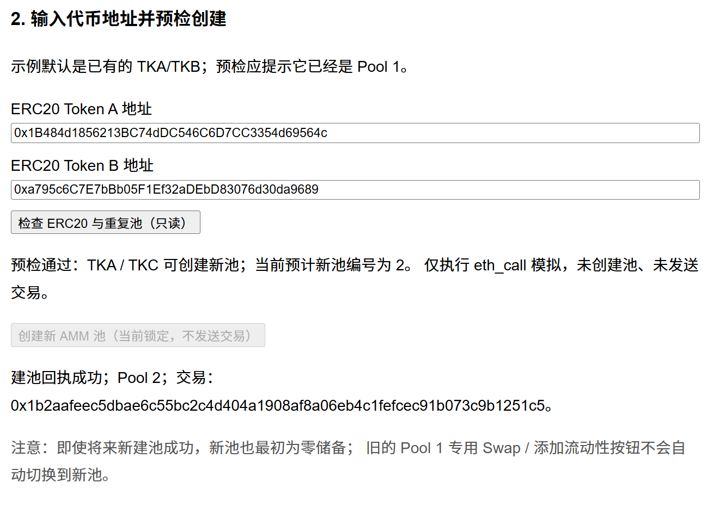

*图 1　Pool 2 在 Ganache 1337 上通过网页创建的历史记录。*

### 2.2 恒定乘积与手续费

交易池按照恒定乘积模型定价。在不计手续费时，两种代币的储备满足：

$$
x\,y=k
$$

其中，$x$ 和 $y$ 分别是池内两种代币的储备，$k$ 是它们的乘积。实际 Swap 使用 **0.3%** 输入手续费，报价的整数计算可写为：

$$
\Delta y=\left\lfloor\frac{997\,\Delta x\,y}{1000x+997\,\Delta x}\right\rfloor
$$

公式里的 `997/1000` 就是扣除手续费后的有效输入比例。输出使用整数向下取整，交易时还通过 `minAmountOut` 约束最小接收数量。**0.3% 交易手续费**和前端设置的 **1% 滑点保护**是不同的东西，前者影响报价，后者用于限制价格变化带来的不利成交。

### 2.3 实际 Swap

Pool 1 完成过真实网页 Swap，交易后 TKA/TKB 储备发生变化。现在的页面（经过美化调整过）将实际 Swap 入口放在左侧，右侧独立提供跨池的双向只读报价；只读报价不调用钱包签名，也不会发送交易。

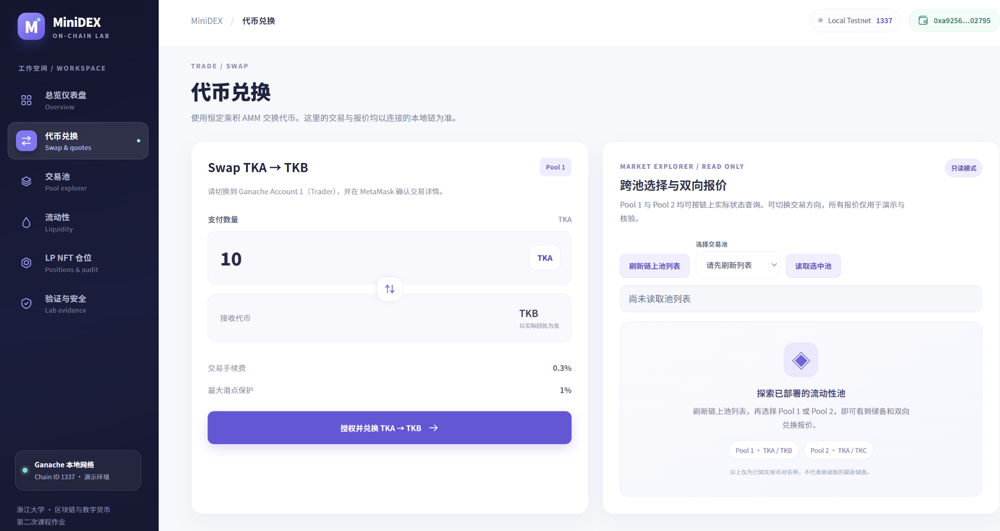

*图 2　新版 Swap 页面。截图中右侧池列表尚未刷新，因此没有把空状态当作实时报价结果。*

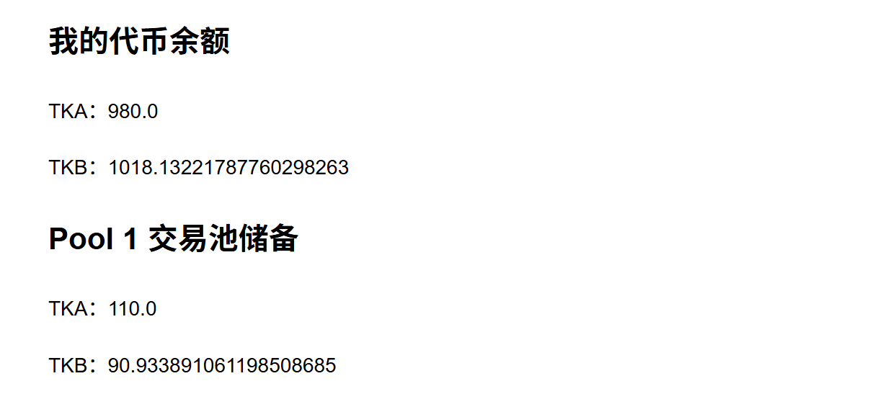

*图 3　此前网页真实 Swap 后的记录，用于说明链上交易流程已经跑通。*

## 3. 流动性与 LP NFT

### 3.1 份额如何计算

第一次向空池添加流动性时，合约按两种投入量的几何平均数铸造份额：`sqrt(amountA * amountB)`。当池已经存在后，新增投入必须与现有储备保持比例一致，并按照当前总份额分配新的 LP 份额。

与直接记录“这个地址占有多少流动性”不同，MiniDEX 为每次成功加池生成独立的 ERC721 NFT。仓位中保存池 ID、原始投入、份额和创建时间，之后可按该 NFT 单独赎回。

### 3.2 Pool 2 的加池与赎回过程

Pool 2 初始流动性为 **100 TKA + 100 TKC**。为验证非首次加池，我又在同一池中追加 **10 TKA + 10 TKC**。加池前先读取储备、钱包余额和授权额度；当时两种代币的 allowance 都是 0，因此必须分开完成授权，再执行加池。

成功交易铸造了 **NFT #6**，份额为 **10**。池储备从 100/100 增加到 110/110，总份额从 100 增加到 110。值得注意的是，此处并未把预估编号当作结果，而是以真实回执中的 NFT 编号为准。

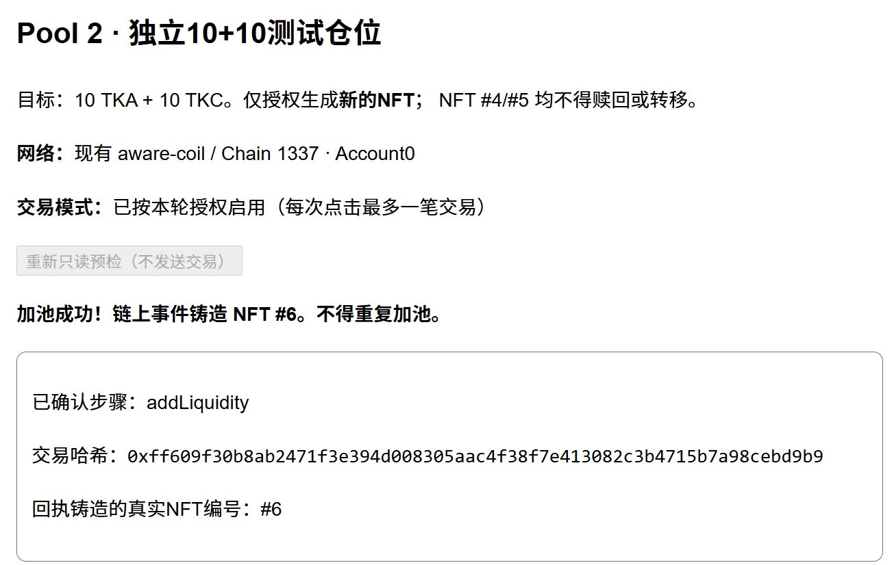

*图 4　追加 10+10 后铸造 NFT #6 的回执；交易哈希：`0xff609f30b8ab2471f3e394d008305aac4f38f7e413082c3b4715b7a98cebd9b9`。*

随后选择 NFT #6 进行撤池测试。赎回前通过只读检查确认持有人、仓位份额和预计返还数量，再执行一笔 `removeLiquidity`。实际收到 **10 TKA + 10 TKC**，NFT #6 的仓位被赎回，Pool 2 储备和总份额均恢复到 100。

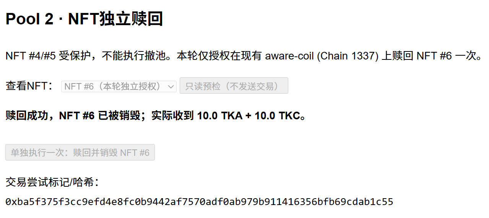

*图 5　NFT #6 赎回成功的网页回执；交易哈希：`0xba5f375f3cc9efd4e8fc0b9442af7570adf0ab979b911416356bfb69cdab1c55`。*

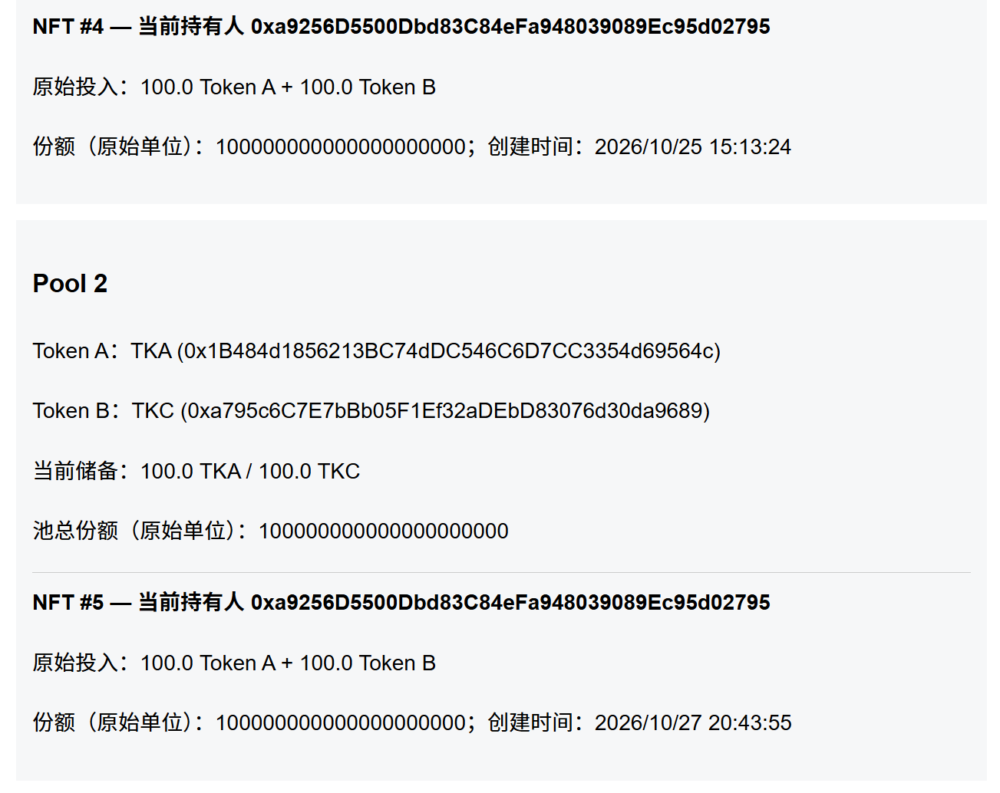

*图 6　赎回后 Pool 2 恢复到 100/100，NFT #6 不再作为活跃 LP 来源。。*

赎回并不是按原始投入数量固定返还。若用户持有份额 $s$，池当前总份额为 $S$、两种储备分别为 $R_A$ 和 $R_B$，那么理论返还数量是：

$$
A_{out}=\left\lfloor\frac{sR_A}{S}\right\rfloor,\qquad
B_{out}=\left\lfloor\frac{sR_B}{S}\right\rfloor
$$

因此，在发生 Swap 后，即便 LP 份额没有改变，最终取回的两种代币数量也可能不同于投入时。NFT #4（Pool 1）和 NFT #5（Pool 2）保留为原有仓位，本次赎回只针对 NFT #6。

### 3.3 仓位与流动性来源查询

前端可以按池查看活跃 LP NFT，也能读取 NFT 持有人、原始投入和创建时间。新版页面把这些数据放在单独的“LP NFT 仓位”区域，并将历史赎回、安全核验与普通信息查询区分开。

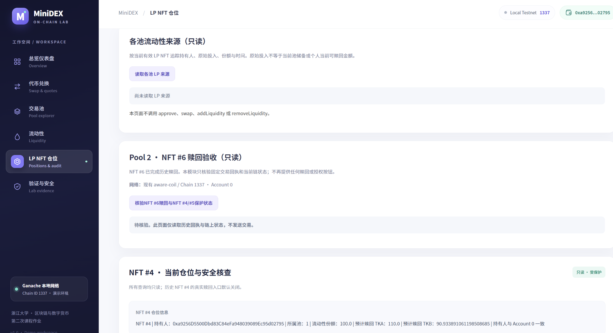

*图 7　新版 LP NFT 页面。部分卡片需要点击只读查询后才显示最新状态。*

## 4. 20 位用户持续模拟与费用分析

### 4.1 模拟方式

我没有用 Ganache 的历史工作区跑批量测试，而是用 Hardhat EDR 31337 单独部署合约。测试包含 **20 个不同地址**。每个地址都完成领取、授权、加池、Swap 和撤池动作；Swap 阶段按固定顺序轮换用户、双向交易，持续时间设为 60 秒。

这更接近一项可重复的持续功能测试，而不是测量系统的最大 TPS。它的目的主要是检查交易长时间连续执行时，储备、NFT 份额和用户资产记录是否保持一致。

| 操作       | 交易数  |
|:---------- | -------:|
| ERC20 领取 | 40      |
| ERC20 授权 | 40      |
| 添加流动性 | 20      |
| 双向 Swap  | 554     |
| 撤出流动性 | 20      |
| **合计**   | **674** |

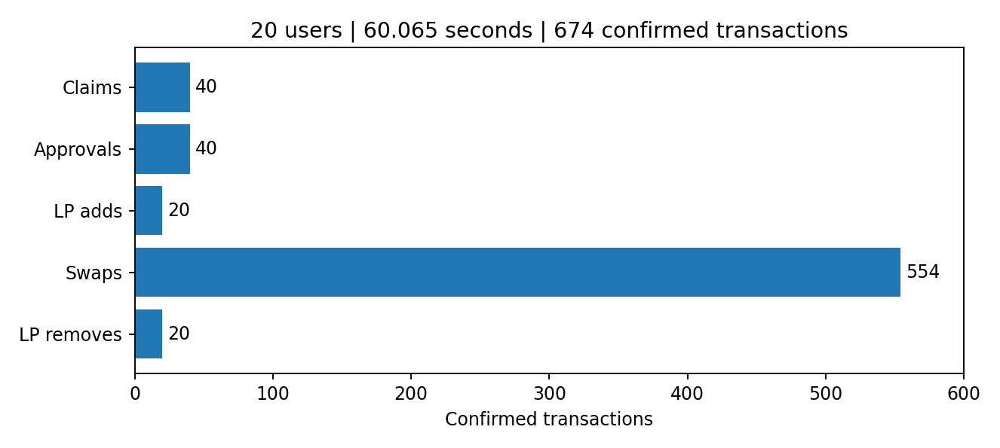

*图 8　持续模拟中各类交易的数量；数据来自保存的 JSON 报告。*

本次回归实测 **60.065 秒**，共确认 **674 笔交易**，其中 **554 次 Swap**，两种交易方向各 277 次；报告记录的失败交易为 **0**。每位用户的 LP 仓位也都有单独的核算记录。

### 4.2 手续费和 LP 收益的区别

这里曾经容易混淆两个概念：**交易收取了多少手续费**，以及 **LP 最后取回的资产比投入多了多少**。我是查询了有关资料后才知晓其中区别。

20 用户测试中，TKA 和 TKB 两个输入方向的交易量各为 **27.7**，按 0.3% 费率估算，各自手续费为 **0.0831 枚对应代币**。两种代币不能在没有价格换算的情况下直接相加成一种币的收益。

在撤池前，池的储备变化为：

| 口径                 | TKA                    | TKB                    |
|:-------------------- | ----------------------:| ----------------------:|
| 初始储备             | 200                    | 200                    |
| 554 次 Swap 后       | 200.071034144266621984 | 200.095125164232252915 |
| 相对初始值的数量变化 | +0.071034144266621984  | +0.095125164232252915  |

这两项数量变化**不能直接称为 LP 净利润**，因为交易也改变了池内的代币组成。

为了检查费用模型，我把 554 次 Swap 的方向和输入数量按原顺序重放，重新执行与合约一致的整数计算，得到的储备与报告逐 wei 一致。随后又把相同交易序列放进一个“不收手续费”的反事实池中比较：

| 模型             | TKA 终态储备           | TKB 终态储备           |
|:---------------- | ----------------------:| ----------------------:|
| 实际 0.3% 费率   | 200.071034144266621984 | 200.095125164232252915 |
| 不收手续费的对照 | 199.987903091146271666 | 200.012097640574005464 |

按照**实际终态池边际价格**把两种资产统一折成 TKA，含费池相对无费对照的模型价值差约为 **0.16614858 TKA**。这是“固定同一交易序列”的比较，不是 LP 在真实市场中额外领取的现金分红，也没有将价格波动及无常损失完全剥离。

原始记录保存在 `evidence/reports/20-users-sustained-final.json` 和 `evidence/reports/lp-fee-counterfactual.json`，便于复查计算过程。

## 5. Bonus：双 DEX 原子套利

### 5.1 价差不是预先设好的

基础测试曾直接给两个 DEX 不同的初始储备，用来检验套利合约能否盈利。为了更贴近PPT课件中对 Bonus 的要求，我又增加了一个实验：**两个独立 DEX 从相同价格开始，由模拟用户交易产生价差**。

测试在 EDR 31337 上部署两个 MiniDEX 实例，初始 TKA/TKB 价格均为 B/A = 1。随后由 **8 个不同模拟交易地址**按固定种子 `20261028` 执行 **20 笔交易**。交易完成后，两个池的边际价格分别变为：

| 状态       | DEX 1（B/A） | DEX 2（B/A） |
|:---------- | ------------:| ------------:|
| 初始价格   | 1.000000     | 1.000000     |
| 用户交易后 | 0.743491     | 1.368262     |

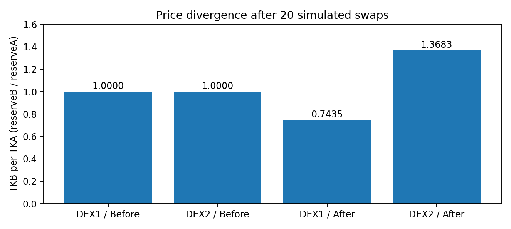

*图 9　20 笔模拟交易使两个 DEX 的价格发生分化。这里是 8 个交易地址，不是 20 个独立用户。*

### 5.2 自动比较报价并执行套利

检测逻辑当然不能只比较标称价格，而是应当按当前储备计算两条路线的**两次实际 Swap 报价**，其中都包含 0.3% 的交易手续费。给定 **5 TKA** 本金，可以发现检测到更有利的路线为 `DEX2_to_DEX1`：

1. 在 DEX 2 使用 TKA 买入 TKB；
2. 将得到的 TKB 在 DEX 1 卖出，换回 TKA。

| 项目                   | 实测结果                     |
|:---------------------- | ----------------------------:|
| 投入                   | 5 TKA                        |
| 第一次 Swap 得到       | 6.445055888983176297 TKB     |
| 第二次 Swap 换回       | 8.043361852507376573 TKA     |
| **毛利润**             | **3.043361852507376573 TKA** |
| 同一回执中的 Swap 事件 | 2 次                         |
| Gas 使用量             | 166,829 units                |

测试回执中两次 Swap 事件来自**同一笔交易**。当把最低利润目标设为不可能达到的 100 TKA 时，整笔调用回滚，两个 DEX 的储备和套利合约余额均保持不变。这是实验对原子性的主要验证。

此次套利使用预先准备的测试 Token 作为本金。Gas 成本记录为 **22070976213 wei**（原生测试币），不能在缺少合理汇率时直接从以 TKA 计价的毛利润中扣除。

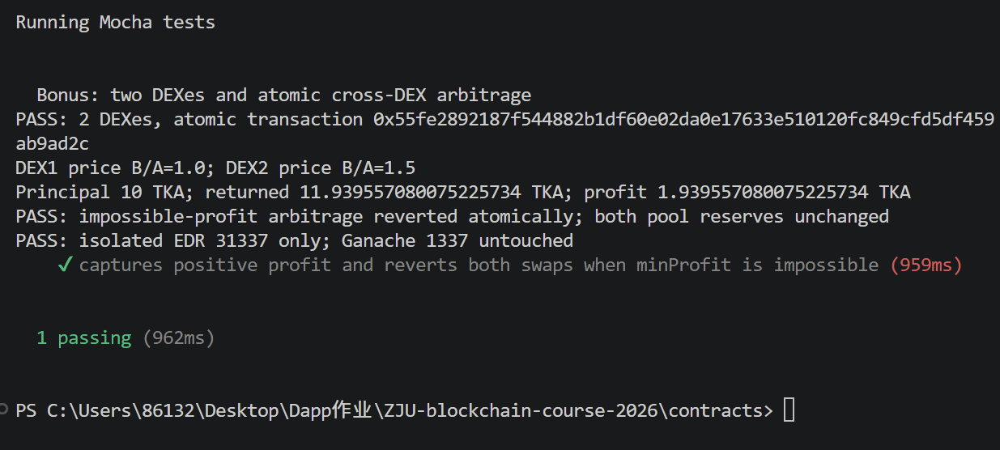

*图 10　较早的基础测试采用预设价差；本节 5 TKA 的增强实验以 `bonus-rubric-final.json` 为准，二者不是同一次交易。*

## 6. 前端展示与测试复现

### 6.1 页面组织

最初页面按功能逐段堆叠，操作入口分散，录屏时也很难在短时间内展示完整流程。后来把界面整理为六个区域：总览、代币兑换、交易池、流动性、LP NFT 仓位、验证与安全。这样既能保留真实业务入口，又能将只读查询和历史测试成果单独展示。

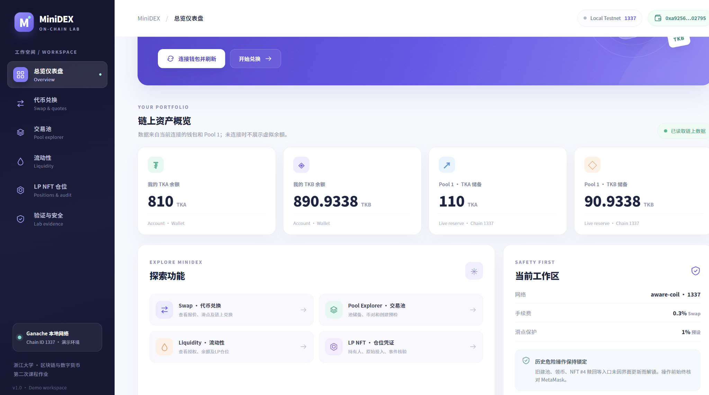

*图 11　连接 Ganache 1337 钱包后的首页，可查看余额和 Pool 1 储备。*

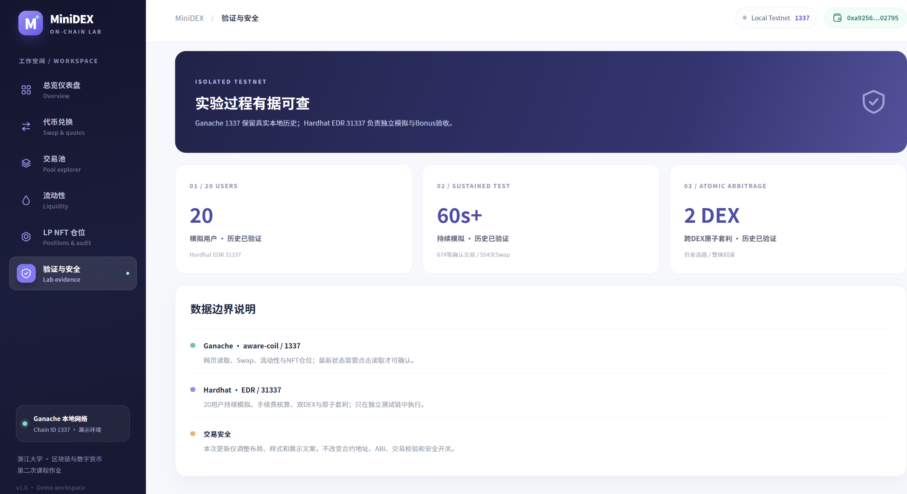

*图 12　实验验证页区分 Ganache 1337 的历史交易和 Hardhat 31337 的模拟结果。*

### 6.2 本地运行与回归命令

项目在 Windows 环境中运行，前端与合约分别安装依赖。隔离测试不需要连接 Ganache：

```powershell
# 项目根目录下
Set-Location .\contracts
npm install
npx hardhat compile
npx hardhat test mocha test/bonus-atomic-arbitrage.test.mjs test/bonus-rubric-coverage.test.mjs --network hardhat

$env:SIMULATION_DURATION_MS = '60000'
$env:SIMULATION_INTERVAL_MS = '100'
npx hardhat test mocha test/simulation-20-users.test.mjs --network hardhat

Set-Location ..\frontend
npm install
npm test
npm run typecheck
npm run build
npm run dev
```

测试报告里已经记录了 Bonus 两个用例通过、20 人持续模拟通过；此前前端有 **5 个测试文件、12 项测试**通过的记录。**视觉界面最新 V2 安装后尚缺一张完整前端回归输出**，因此提交前仍应在当前本地源码上再运行一次 `npm test`、`npm run typecheck` 和 `npm run build`。不要把旧版构建通过记录直接当作这次视觉改造的验证结果。

## 7. 遇到的问题与实验总结

项目中有几处问题值得记录。

**第一，授权额度与真实交易是两回事。** Pool 2 准备追加 10+10 时，账户余额充足，但两种 Token 的 allowance 都为 0。需要先分别授权，才能执行加池。后来将只读预检和正式写入分开，减少了重复发送交易的风险。但是每次授权之前都需要进行模拟交易，较为耗费时间，效率不是很高，希望以后可以改进方法。

**第二，合约编译与测试环境需要分别排查。** Bonus 合约一度遇到 Solidity `Stack too deep`，调整编译设置中的优化器和 `viaIR` 后解决。20 用户模拟曾因 Hardhat 3 环境中的 `ethers` 引用方式不匹配而在运行开始前失败，修正引用后测试才真正通过。这些错误和 AMM 交易公式本身无关。

**第三，NFT 的“原始投入”和“现在能取回多少”不能混用。** 份额代表的是池资产的比例；发生交易之后，池储备变了，NFT 的赎回金额自然也可能变化。费用分析也是如此，单纯比较最终余额并不能把手续费贡献、市场价格变化和无常损失完全区分。

**第四，测试结果要说明网络环境。** Ganache 的历史交易哈希和 NFT 编号来自现有本地链，Hardhat 的交易是可重复的隔离测试，两者不能互相替代。

从结果看，MiniDEX 已经覆盖了 ERC20 领取、网页建池、Swap、LP NFT 添加和赎回等主要功能；20 用户持续模拟和 Bonus 原子套利也有对应测试与数据文件。仍需注意，这是一套课程实验环境，未进行公开网络中的安全审计或实际经济风险评估，不能把本地测试的盈利数字理解成真实市场中可获得的利润。

## 资料与证据

- 课程作业要求：`docs/OFFICIAL_REQUIREMENTS.txt`（两版 PPT 的作业页转录）。
- 智能合约：`contracts/contracts/MiniDEX.sol`、`MockToken.sol`、`BonusAtomicArbitrage.sol`。
- 持续模拟：`evidence/reports/20-users-sustained-final.json`。
- LP 费用对照：`evidence/reports/lp-fee-counterfactual.json`。
- Bonus：`evidence/reports/bonus-rubric-final.json`。
- 相关页面、交易和回执截图：`docs/images/`；统计图：`docs/figures/`。
- 课程提供的参考项目：<https://github.com/LBruyne/ZJU-blockchain-course-2026>。
